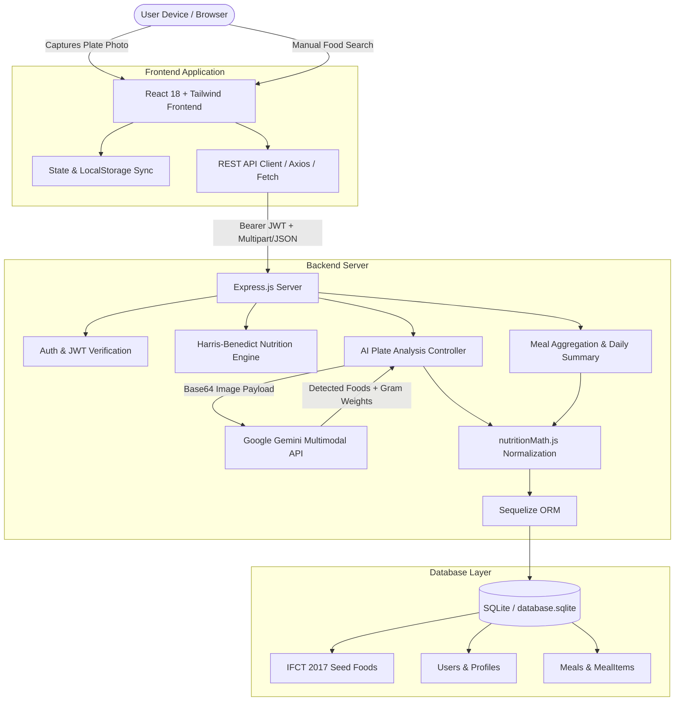

# FoodPlate Tracking System — Project Report & Source Code Dossier

**Project Title:** FoodPlate — AI-Powered Food and Nutrition Tracking System  
**Stack:** Node.js, Express.js, Sequelize ORM, SQLite, Google Gemini 1.5/2.0 Multimodal API, React 18, Vite, Tailwind CSS, Lucide Icons  
**Dataset Reference:** Indian Food Composition Tables (IFCT 2017) — National Institute of Nutrition (ICMR)  

---

## 1. Project Abstract & Overview

Modern dietary logging systems often suffer from significant user friction: manual entry of food weights and portion sizes is tedious and prone to human error, while Western food databases (e.g., USDA) lack nutritional composition for regional South Asian and Indian culinary preparations.

The **FoodPlate Tracking System** solves this challenge through a **Hybrid AI Vision & Deterministic Nutrition Calculation Pipeline**:
1. **Multimodal AI Plate Detection:** Leverages Google Gemini Multimodal Vision to inspect photographs of food plates, identify individual items (e.g., Dal Tadka, Chapati, Cooked White Rice), estimate visual portion weights in grams, and assign confidence ratings.
2. **Deterministic Nutritional Engine:** Instead of relying on hallucinated generative numbers for calories, all identified items are cross-referenced with a verified regional database derived from the **Indian Food Composition Tables (IFCT 2017)**.
3. **Automated Personalization:** Calculates tailored Basal Metabolic Rate (BMR) and Total Daily Energy Expenditure (TDEE) based on user demographics using the **Harris-Benedict equation**, dynamically deriving daily calorie, protein, carbohydrate, fat, and fiber targets.
4. **Resilient Offline Architecture:** Includes graceful fallbacks with client-side local caching and offline mock models so users can record meals even when network connectivity or API services fluctuate.

---

## 2. System Architecture



---

## 3. Mathematical Foundations & Algorithms

### 3.1 Portion Normalization & Nutrient Scaling
Every verified food item in the database contains nutrient density values per $100\,\text{g}$ (or $100\,\text{ml}$). When a user logs a custom serving unit (e.g., $N$ bowls, $M$ chapatis):

$$\text{Normalized Weight } (W) = Q \times C$$

Where:
* $Q$ = Logged quantity (e.g., $1.5$ bowls)
* $C$ = Conversion factor to grams (e.g., $150\,\text{g}$ per standard bowl)

The consumed nutrient $Y$ (Calories, Protein, Carbs, Fat, Fiber, Sodium) is deterministically calculated as:

$$Y_{\text{consumed}} = Y_{\text{per 100g}} \times \left( \frac{W}{100} \right)$$

### 3.2 Total Daily Energy Expenditure (TDEE) & Macro Targets
Basal Metabolic Rate ($BMR$) is calculated using the Mifflin-St Jeor / Harris-Benedict formulation:

$$BMR = 10 \times \text{weight (kg)} + 6.25 \times \text{height (cm)} - 5 \times \text{age (years)} + 5$$

Total Daily Energy Expenditure ($TDEE$) is obtained by multiplying $BMR$ by physical activity level multiplier $\alpha$:
* Sedentary: $\alpha = 1.20$
* Lightly Active: $\alpha = 1.375$
* Moderately Active: $\alpha = 1.55$
* Very Active: $\alpha = 1.725$

Goal adjustment:
$$\text{Calorie Target } (T) = (\alpha \times BMR) \pm \Delta$$
* Weight loss: $\Delta = -500\,\text{kcal}$
* Weight gain: $\Delta = +500\,\text{kcal}$

Macronutrient targets:
* $\text{Protein Target (g)} = \frac{T \times 0.20}{4}$
* $\text{Carbohydrate Target (g)} = \frac{T \times 0.50}{4}$
* $\text{Fat Target (g)} = \frac{T \times 0.30}{9}$
* $\text{Fiber Target (g)} = \left(\frac{T}{1000}\right) \times 14$

---

## 4. Database Schema (Sequelize ORM)

| Table | Primary Key | Key Attributes | Foreign Keys / Associations |
|---|---|---|---|
| **Users** | `id` (UUID) | `email`, `passwordHash`, `createdAt` | HasOne `UserProfile`, HasMany `Meal` |
| **UserProfiles** | `userId` (UUID) | `age`, `heightCm`, `weightKg`, `activityLevel`, `fitnessGoal`, `dietaryPreference`, `dailyCalorieTarget`, `dailyProteinTargetG`, `dailyCarbsTargetG`, `dailyFatTargetG`, `dailyFiberTargetG` | BelongsTo `User` |
| **Foods** | `id` (UUID) | `name`, `regionalName`, `foodType`, `verified`, `servingSizeDefault`, `servingUnitDefault`, `conversionToGrams`, `caloriesPer100g`, `proteinPer100g`, `carbsPer100g`, `fatPer100g`, `fiberPer100g`, `sodiumPer100g` | HasMany `MealItem` |
| **Meals** | `id` (UUID) | `userId`, `mealType`, `logDate`, `logTime`, `totalCalories`, `totalProteinG`, `totalCarbsG`, `totalFatG`, `totalFiberG`, `analysisMethod`, `imageUrl` | BelongsTo `User`, HasMany `MealItem` |
| **MealItems** | `id` (UUID) | `mealId`, `foodId`, `loggedQuantity`, `loggedUnit`, `normalizedGrams`, `calories`, `protein`, `carbs`, `fat`, `fiber`, `estimationType` | BelongsTo `Meal`, BelongsTo `Food` |

---

## 5. Backend Source Code

### 5.1 `backend/package.json`
```json
{
  "name": "foodplate-tracking-backend",
  "version": "1.0.0",
  "description": "Backend API server for FoodPlate Tracking System",
  "main": "src/app.js",
  "scripts": {
    "start": "node src/app.js",
    "dev": "nodemon src/app.js",
    "test": "jest"
  },
  "dependencies": {
    "@google/genai": "^2.24.0",
    "bcryptjs": "^2.4.3",
    "cors": "^2.8.5",
    "dotenv": "^16.4.5",
    "express": "^4.19.2",
    "jsonwebtoken": "^9.0.2",
    "multer": "^1.4.5-lts.1",
    "sequelize": "^6.37.3",
    "sqlite3": "^5.1.7"
  },
  "devDependencies": {
    "jest": "^29.7.0",
    "nodemon": "^3.1.0",
    "supertest": "^6.3.4"
  }
}
```

---

### 5.2 `backend/src/config/db.js`
```javascript
const { Sequelize, DataTypes } = require('sequelize');
const path = require('path');
const seedFoods = require('../utils/seedData');

// Resolve database storage path
const dbPath = path.resolve(__dirname, '../../database.sqlite');

const sequelize = new Sequelize({
  dialect: 'sqlite',
  storage: dbPath,
  logging: false
});

// Model Declarations
const User = sequelize.define('User', {
  id: {
    type: DataTypes.UUID,
    defaultValue: Sequelize.UUIDV4,
    primaryKey: true
  },
  email: {
    type: DataTypes.STRING,
    allowNull: false,
    unique: true
  },
  passwordHash: {
    type: DataTypes.STRING,
    allowNull: false
  }
});

const UserProfile = sequelize.define('UserProfile', {
  userId: {
    type: DataTypes.UUID,
    primaryKey: true
  },
  age: DataTypes.INTEGER,
  heightCm: DataTypes.FLOAT,
  weightKg: DataTypes.FLOAT,
  activityLevel: DataTypes.STRING, // sedentary, lightly_active, moderately_active, very_active
  fitnessGoal: DataTypes.STRING,   // lose_weight, maintain_weight, gain_weight
  dietaryPreference: {
    type: DataTypes.STRING,
    defaultValue: 'omnivore'        // vegetarian, vegan, jain, eggitarian
  },
  allergenList: DataTypes.TEXT,     // comma-separated list
  dailyCalorieTarget: DataTypes.INTEGER,
  dailyProteinTargetG: DataTypes.FLOAT,
  dailyCarbsTargetG: DataTypes.FLOAT,
  dailyFatTargetG: DataTypes.FLOAT,
  dailyFiberTargetG: DataTypes.FLOAT
});

const Food = sequelize.define('Food', {
  id: {
    type: DataTypes.UUID,
    defaultValue: Sequelize.UUIDV4,
    primaryKey: true
  },
  name: {
    type: DataTypes.STRING,
    allowNull: false
  },
  regionalName: DataTypes.STRING,
  foodType: {
    type: DataTypes.STRING,
    defaultValue: 'cooked' // raw, cooked, packaged
  },
  verified: {
    type: DataTypes.BOOLEAN,
    defaultValue: false
  },
  barcode: DataTypes.STRING,
  servingSizeDefault: {
    type: DataTypes.FLOAT,
    allowNull: false
  },
  servingUnitDefault: {
    type: DataTypes.STRING,
    allowNull: false // g, ml, piece, cup, bowl, slice
  },
  conversionToGrams: {
    type: DataTypes.FLOAT,
    allowNull: false,
    defaultValue: 1.0
  },
  caloriesPer100g: {
    type: DataTypes.FLOAT,
    allowNull: false
  },
  proteinPer100g: {
    type: DataTypes.FLOAT,
    allowNull: false
  },
  carbsPer100g: {
    type: DataTypes.FLOAT,
    allowNull: false
  },
  fatPer100g: {
    type: DataTypes.FLOAT,
    allowNull: false
  },
  fiberPer100g: {
    type: DataTypes.FLOAT,
    defaultValue: 0.0
  },
  sodiumPer100g: {
    type: DataTypes.FLOAT,
    defaultValue: 0.0
  }
});

const Meal = sequelize.define('Meal', {
  id: {
    type: DataTypes.UUID,
    defaultValue: Sequelize.UUIDV4,
    primaryKey: true
  },
  userId: {
    type: DataTypes.UUID,
    allowNull: false
  },
  mealType: {
    type: DataTypes.STRING,
    allowNull: false // Breakfast, Lunch, Dinner, Snack, Custom
  },
  logDate: {
    type: DataTypes.DATEONLY,
    allowNull: false
  },
  logTime: {
    type: DataTypes.TIME,
    allowNull: false
  },
  totalCalories: DataTypes.FLOAT,
  totalProteinG: DataTypes.FLOAT,
  totalCarbsG: DataTypes.FLOAT,
  totalFatG: DataTypes.FLOAT,
  totalFiberG: DataTypes.FLOAT,
  analysisMethod: {
    type: DataTypes.STRING,
    allowNull: false // image, manual, hybrid
  },
  imageUrl: DataTypes.TEXT
});

const MealItem = sequelize.define('MealItem', {
  id: {
    type: DataTypes.UUID,
    defaultValue: Sequelize.UUIDV4,
    primaryKey: true
  },
  mealId: {
    type: DataTypes.UUID,
    allowNull: false
  },
  foodId: {
    type: DataTypes.UUID,
    allowNull: false
  },
  loggedQuantity: {
    type: DataTypes.FLOAT,
    allowNull: false
  },
  loggedUnit: {
    type: DataTypes.STRING,
    allowNull: false
  },
  normalizedGrams: {
    type: DataTypes.FLOAT,
    allowNull: false
  },
  calories: DataTypes.FLOAT,
  protein: DataTypes.FLOAT,
  carbs: DataTypes.FLOAT,
  fat: DataTypes.FLOAT,
  fiber: DataTypes.FLOAT,
  estimationType: {
    type: DataTypes.STRING,
    defaultValue: 'verified_db' // verified_db, ai_estimated, user_corrected
  }
});

// Relationships
User.hasOne(UserProfile, { foreignKey: 'userId', onDelete: 'CASCADE' });
UserProfile.belongsTo(User, { foreignKey: 'userId' });

User.hasMany(Meal, { foreignKey: 'userId', onDelete: 'CASCADE' });
Meal.belongsTo(User, { foreignKey: 'userId' });

Meal.hasMany(MealItem, { foreignKey: 'mealId', onDelete: 'CASCADE' });
MealItem.belongsTo(Meal, { foreignKey: 'mealId' });

Food.hasMany(MealItem, { foreignKey: 'foodId', onDelete: 'RESTRICT' });
MealItem.belongsTo(Food, { foreignKey: 'foodId' });

// Initialize Database Function
async function initDatabase() {
  try {
    await sequelize.authenticate();
    console.log('SQLite database connection established successfully.');

    // Sync models to database schemas
    await sequelize.sync();
    console.log('Database schemas synchronized.');

    // Check if foods table requires seeding
    const foodCount = await Food.count();
    if (foodCount === 0) {
      console.log('Seeding initial verified Indian foods database...');
      await Food.bulkCreate(seedFoods);
      console.log('Foods database seeded successfully.');
    }
  } catch (error) {
    console.error('Unable to initialize the SQLite database:', error);
    throw error;
  }
}

module.exports = {
  sequelize,
  User,
  UserProfile,
  Food,
  Meal,
  MealItem,
  initDatabase
};
```

---

### 5.3 `backend/src/utils/nutritionMath.js`
```javascript
/**
 * Deterministic math calculations for food portion and nutrient tracking.
 * All base database items store nutrient counts PER 100g (or 100ml).
 */

/**
 * Normalizes a custom unit quantity (e.g. 2 pieces, 1.5 bowls) to absolute weight in grams.
 * 
 * @param {number} quantity - The numeric logged quantity
 * @param {number} conversionToGrams - Weight in grams of exactly 1 unit of this food
 * @returns {number} The normalized weight in grams
 */
function normalizeToGrams(quantity, conversionToGrams) {
  if (!quantity || quantity <= 0) return 0;
  return Number((quantity * conversionToGrams).toFixed(2));
}

/**
 * Calculates nutrients consumed for a specific food portion size.
 * Formula: (Normalized Grams / 100) * Nutrient Value per 100g
 * 
 * @param {number} normalizedGrams - The absolute weight consumed in grams
 * @param {number} nutrientPer100g - Nutrient density (calories, protein, etc.) per 100g
 * @returns {number} Rounded nutrient value
 */
function calculateNutrient(normalizedGrams, nutrientPer100g) {
  if (!normalizedGrams || normalizedGrams <= 0 || !nutrientPer100g) return 0;
  return Number(((normalizedGrams / 100) * nutrientPer100g).toFixed(2));
}

/**
 * Calculates complete macro profile for a single logged item.
 * 
 * @param {number} quantity - Quantity consumed
 * @param {number} conversionToGrams - Conversion factor to grams
 * @param {object} foodNutrients - Object containing calories, protein, carbs, fat, fiber
 * @returns {object} Calculated totals
 */
function calculateItemNutrients(quantity, conversionToGrams, foodNutrients) {
  const normalizedGrams = normalizeToGrams(quantity, conversionToGrams);
  
  return {
    normalizedGrams,
    calories: calculateNutrient(normalizedGrams, foodNutrients.caloriesPer100g),
    protein: calculateNutrient(normalizedGrams, foodNutrients.proteinPer100g),
    carbs: calculateNutrient(normalizedGrams, foodNutrients.carbsPer100g),
    fat: calculateNutrient(normalizedGrams, foodNutrients.fatPer100g),
    fiber: calculateNutrient(normalizedGrams, foodNutrients.fiberPer100g),
    sodium: calculateNutrient(normalizedGrams, foodNutrients.sodiumPer100g || 0)
  };
}

/**
 * Sums nutrient values across multiple meal items to get total plate calculations.
 * 
 * @param {Array} items - List of calculated meal items
 * @returns {object} Summed total nutrition object
 */
function calculateMealTotals(items) {
  const totals = {
    totalCalories: 0,
    totalProtein: 0,
    totalCarbs: 0,
    totalFat: 0,
    totalFiber: 0,
    totalSodium: 0
  };

  if (!Array.isArray(items)) return totals;

  items.forEach(item => {
    totals.totalCalories += item.calories || 0;
    totals.totalProtein += item.protein || 0;
    totals.totalCarbs += item.carbs || 0;
    totals.totalFat += item.fat || 0;
    totals.totalFiber += item.fiber || 0;
    totals.totalSodium += item.sodium || 0;
  });

  // Round results to 2 decimal places
  Object.keys(totals).forEach(key => {
    totals[key] = Number(totals[key].toFixed(2));
  });

  return totals;
}

module.exports = {
  normalizeToGrams,
  calculateNutrient,
  calculateItemNutrients,
  calculateMealTotals
};
```

---

### 5.4 `backend/src/services/gemini.js`
```javascript
const { GoogleGenAI } = require('@google/genai');

// Ensure client runs only if API Key is supplied
const apiKey = process.env.GEMINI_API_KEY;
let aiClient = null;

if (apiKey) {
  aiClient = new GoogleGenAI({ apiKey });
} else {
  console.warn('WARNING: GEMINI_API_KEY environment variable is not defined. AI analysis endpoints will run in demo/offline mode.');
}

/**
 * Helper to strip markdown formatting and parse JSON safely
 */
function cleanAndParseJSON(text) {
  if (!text) return null;
  let cleaned = text.trim();
  if (cleaned.startsWith('```')) {
    cleaned = cleaned.replace(/^```(?:json)?\s*/i, '').replace(/\s*```$/, '').trim();
  }
  return JSON.parse(cleaned);
}

/**
 * Sleep helper for retry delays
 */
function sleep(ms) {
  return new Promise(resolve => setTimeout(resolve, ms));
}

/**
 * Generate content with model fallback and retry logic for transient errors
 */
async function generateWithFallback(contents, config = {}) {
  const candidateModels = ['gemini-2.0-flash', 'gemini-1.5-flash'];
  const MAX_RETRIES = 3;
  let lastError = null;

  for (const model of candidateModels) {
    for (let attempt = 1; attempt <= MAX_RETRIES; attempt++) {
      try {
        console.log(`[Gemini Service] Trying model ${model} (attempt ${attempt}/${MAX_RETRIES})...`);
        const response = await aiClient.models.generateContent({
          model,
          contents,
          config: {
            responseMimeType: 'application/json',
            ...config
          }
        });
        if (response && response.text) {
          console.log(`[Gemini Service] Model ${model} succeeded on attempt ${attempt}.`);
          return cleanAndParseJSON(response.text);
        }
      } catch (err) {
        const status = err.status || err.code;
        lastError = err;
        console.warn(`[Gemini Service] Model ${model} attempt ${attempt} failed (${status || err.message}).`);

        if ([503, 429, 500].includes(status) && attempt < MAX_RETRIES) {
          const delayMs = 1000 * Math.pow(2, attempt - 1);
          console.log(`[Gemini Service] Retrying in ${delayMs}ms...`);
          await sleep(delayMs);
          continue;
        }
        break;
      }
    }
  }

  throw lastError || new Error('All Gemini model fallbacks failed');
}

/**
 * Sends a plate food image to Gemini VLM to identify items, confidence, and visual weights.
 */
async function analyzePlateImage(imageBuffer, mimeType) {
  if (!aiClient) {
    throw new Error('Gemini AI client is uninitialized. Verify GEMINI_API_KEY environment variable.');
  }

  const prompt = `
    You are an expert nutritionist and computer vision system. 
    Analyze this food plate image. Identify every distinct food item visible on the plate.
    If no food item is found, return an empty array in "detected_items".
    For each item:
    1. Detect its name (use international or standard Indian culinary terms like white rice, chapati, dal, paneer butter masala, salad, etc.).
    2. Estimate its visual portion weight in grams based on standard plate sizes and typical serving sizes.
    3. Output your estimation confidence score between 0.0 and 1.0.
    4. Estimate nutritional values PER 100g/100ml for this food item (calories in kcal, protein in grams, carbohydrates in grams, fat in grams, fiber in grams, sodium in milligrams).

    Return the list as a raw JSON array matching this exact JSON schema:
    {
      "detected_items": [
        {
          "food_name": "string",
          "estimated_weight_grams": number,
          "confidence": number,
          "calories_per_100g": number,
          "protein_per_100g": number,
          "carbs_per_100g": number,
          "fat_per_100g": number,
          "fiber_per_100g": number,
          "sodium_per_100g": number
        }
      ]
    }
  `;

  try {
    const base64Data = imageBuffer.toString('base64');
    const contents = [
      {
        inlineData: {
          data: base64Data,
          mimeType: mimeType || 'image/jpeg'
        }
      },
      prompt
    ];

    const parsed = await generateWithFallback(contents);

    if (Array.isArray(parsed)) {
      return { detected_items: parsed };
    }
    if (parsed && Array.isArray(parsed.detected_items)) {
      return parsed;
    }
    if (parsed && Array.isArray(parsed.items)) {
      return { detected_items: parsed.items };
    }

    return { detected_items: [] };
  } catch (error) {
    console.error('Gemini Plate Analysis API Error:', error);
    throw new Error(`AI Plate Analysis failed: ${error.message}`);
  }
}

module.exports = {
  analyzePlateImage
};
```

---

### 5.5 `backend/src/utils/seedData.js` (Excerpts)
```javascript
const seedFoods = [
  {
    name: "Cooked White Rice",
    regionalName: "Rice, Chawal",
    foodType: "cooked",
    verified: true,
    servingSizeDefault: 1,
    servingUnitDefault: "bowl",
    conversionToGrams: 150.0,
    caloriesPer100g: 130.0,
    proteinPer100g: 2.7,
    carbsPer100g: 28.0,
    fatPer100g: 0.3,
    fiberPer100g: 0.4,
    sodiumPer100g: 1.0
  },
  {
    name: "Chapati (Whole Wheat Roti)",
    regionalName: "Roti, Phulka",
    foodType: "cooked",
    verified: true,
    servingSizeDefault: 1,
    servingUnitDefault: "piece",
    conversionToGrams: 40.0,
    caloriesPer100g: 260.0,
    proteinPer100g: 8.0,
    carbsPer100g: 55.0,
    fatPer100g: 1.5,
    fiberPer100g: 7.0,
    sodiumPer100g: 120.0
  },
  {
    name: "Dal Tadka (Cooked)",
    regionalName: "Dal, Yellow Dal",
    foodType: "cooked",
    verified: true,
    servingSizeDefault: 1,
    servingUnitDefault: "bowl",
    conversionToGrams: 150.0,
    caloriesPer100g: 110.0,
    proteinPer100g: 5.0,
    carbsPer100g: 16.0,
    fatPer100g: 3.5,
    fiberPer100g: 4.0,
    sodiumPer100g: 280.0
  },
  {
    name: "Paneer Butter Masala",
    regionalName: "Paneer Curry",
    foodType: "cooked",
    verified: true,
    servingSizeDefault: 1,
    servingUnitDefault: "bowl",
    conversionToGrams: 200.0,
    caloriesPer100g: 220.0,
    proteinPer100g: 9.0,
    carbsPer100g: 8.0,
    fatPer100g: 18.0,
    fiberPer100g: 1.5,
    sodiumPer100g: 350.0
  },
  {
    name: "Idli (Steam cooked)",
    regionalName: "Idli",
    foodType: "cooked",
    verified: true,
    servingSizeDefault: 1,
    servingUnitDefault: "piece",
    conversionToGrams: 40.0,
    caloriesPer100g: 120.0,
    proteinPer100g: 3.0,
    carbsPer100g: 26.0,
    fatPer100g: 0.2,
    fiberPer100g: 1.0,
    sodiumPer100g: 180.0
  },
  {
    name: "Masala Dosa",
    regionalName: "Dosa, Dosai",
    foodType: "cooked",
    verified: true,
    servingSizeDefault: 1,
    servingUnitDefault: "piece",
    conversionToGrams: 120.0,
    caloriesPer100g: 180.0,
    proteinPer100g: 4.0,
    carbsPer100g: 29.0,
    fatPer100g: 5.5,
    fiberPer100g: 1.8,
    sodiumPer100g: 290.0
  },
  {
    name: "Sambar",
    regionalName: "Sambar, Kuzhambu",
    foodType: "cooked",
    verified: true,
    servingSizeDefault: 1,
    servingUnitDefault: "bowl",
    conversionToGrams: 150.0,
    caloriesPer100g: 80.0,
    proteinPer100g: 3.0,
    carbsPer100g: 12.0,
    fatPer100g: 2.0,
    fiberPer100g: 2.5,
    sodiumPer100g: 310.0
  },
  {
    name: "Curd (Whole Milk Dahi)",
    regionalName: "Dahi, Thayir",
    foodType: "cooked",
    verified: true,
    servingSizeDefault: 1,
    servingUnitDefault: "cup",
    conversionToGrams: 150.0,
    caloriesPer100g: 60.0,
    proteinPer100g: 3.2,
    carbsPer100g: 4.7,
    fatPer100g: 3.2,
    fiberPer100g: 0.0,
    sodiumPer100g: 45.0
  }
];

module.exports = seedFoods;
```

---

### 5.6 `backend/src/app.js` (Core Server & API Controller)
```javascript
require('dotenv').config();
const express = require('express');
const cors = require('cors');
const bcrypt = require('bcryptjs');
const jwt = require('jsonwebtoken');
const multer = require('multer');
const { Op } = require('sequelize');

const { sequelize, User, UserProfile, Food, Meal, MealItem, initDatabase } = require('./config/db');
const { calculateItemNutrients, calculateMealTotals } = require('./utils/nutritionMath');
const { analyzePlateImage } = require('./services/gemini');

const app = express();
const PORT = process.env.PORT || 5000;
const JWT_SECRET = process.env.JWT_SECRET || 'super_secret_jwt_key_change_me';

app.use(cors());
app.use(express.json());

// Set up image upload handler
const upload = multer({
  storage: multer.memoryStorage(),
  limits: { fileSize: (process.env.MAX_FILE_SIZE_MB || 5) * 1024 * 1024 }
});

// Middleware: Authentication
function authenticateToken(req, res, next) {
  const authHeader = req.headers['authorization'];
  const token = authHeader && authHeader.split(' ')[1];
  
  if (!token) {
    return res.status(401).json({ error: 'Access token required. Format: Bearer <token>' });
  }

  jwt.verify(token, JWT_SECRET, (err, decodedUser) => {
    if (err) {
      return res.status(403).json({ error: 'Invalid or expired access token' });
    }
    req.user = decodedUser;
    next();
  });
}

// ---------------------------------------------------------------------
// Auth Routes
// ---------------------------------------------------------------------
app.post('/api/auth/register', async (req, res) => {
  const { email, password } = req.body;
  if (!email || !password) {
    return res.status(400).json({ error: 'Email and password are required' });
  }

  try {
    const existingUser = await User.findOne({ where: { email } });
    if (existingUser) {
      return res.status(400).json({ error: 'A user with this email already exists' });
    }

    const salt = await bcrypt.genSalt(10);
    const passwordHash = await bcrypt.hash(password, salt);
    const newUser = await User.create({ email, passwordHash });
    await UserProfile.create({ userId: newUser.id });

    const token = jwt.sign({ id: newUser.id, email: newUser.email }, JWT_SECRET, { expiresIn: '7d' });
    return res.status(201).json({ token, message: 'User registered successfully' });
  } catch (error) {
    return res.status(500).json({ error: `Registration failed: ${error.message}` });
  }
});

app.post('/api/auth/login', async (req, res) => {
  const { email, password } = req.body;
  if (!email || !password) {
    return res.status(400).json({ error: 'Email and password are required' });
  }

  try {
    const user = await User.findOne({ where: { email } });
    if (!user) return res.status(400).json({ error: 'Invalid email or password' });

    const isMatch = await bcrypt.compare(password, user.passwordHash);
    if (!isMatch) return res.status(400).json({ error: 'Invalid email or password' });

    const token = jwt.sign({ id: user.id, email: user.email }, JWT_SECRET, { expiresIn: '7d' });
    return res.json({ token, message: 'Logged in successfully' });
  } catch (error) {
    return res.status(500).json({ error: `Login failed: ${error.message}` });
  }
});

// ---------------------------------------------------------------------
// Profile Routes (Harris-Benedict Math)
// ---------------------------------------------------------------------
app.get('/api/profile', authenticateToken, async (req, res) => {
  try {
    const profile = await UserProfile.findOne({ where: { userId: req.user.id } });
    return res.json(profile);
  } catch (error) {
    return res.status(500).json({ error: `Failed to fetch profile: ${error.message}` });
  }
});

app.put('/api/profile', authenticateToken, async (req, res) => {
  const { age, heightCm, weightKg, activityLevel, fitnessGoal, dietaryPreference, allergenList } = req.body;
  
  try {
    const profile = await UserProfile.findOne({ where: { userId: req.user.id } });
    if (!profile) return res.status(404).json({ error: 'Profile not found' });

    // Dynamic target calculations using Harris-Benedict formulas
    let bmr = 10 * weightKg + 6.25 * heightCm - 5 * age + 5; 

    let multiplier = 1.2;
    if (activityLevel === 'lightly_active') multiplier = 1.375;
    if (activityLevel === 'moderately_active') multiplier = 1.55;
    if (activityLevel === 'very_active') multiplier = 1.725;

    let dailyCalorieTarget = Math.round(bmr * multiplier);
    if (fitnessGoal === 'lose_weight') dailyCalorieTarget -= 500;
    if (fitnessGoal === 'gain_weight') dailyCalorieTarget += 500;

    const dailyProteinTargetG = Math.round((dailyCalorieTarget * 0.20) / 4);
    const dailyCarbsTargetG = Math.round((dailyCalorieTarget * 0.50) / 4);
    const dailyFatTargetG = Math.round((dailyCalorieTarget * 0.30) / 9);
    const dailyFiberTargetG = Math.round((dailyCalorieTarget / 1000) * 14);

    await profile.update({
      age,
      heightCm,
      weightKg,
      activityLevel,
      fitnessGoal,
      dietaryPreference,
      allergenList,
      dailyCalorieTarget,
      dailyProteinTargetG,
      dailyCarbsTargetG,
      dailyFatTargetG,
      dailyFiberTargetG
    });

    return res.json({ profile, message: 'Profile targets updated successfully' });
  } catch (error) {
    return res.status(500).json({ error: `Failed to update profile: ${error.message}` });
  }
});

// ---------------------------------------------------------------------
// Food Directory Routes
// ---------------------------------------------------------------------
app.get('/api/foods/search', async (req, res) => {
  const { q } = req.query;
  if (!q) return res.json([]);

  try {
    const foods = await Food.findAll({
      where: {
        [Op.or]: [
          { name: { [Op.like]: `%${q}%` } },
          { regionalName: { [Op.like]: `%${q}%` } }
        ]
      },
      limit: 10
    });
    return res.json(foods);
  } catch (error) {
    return res.status(500).json({ error: `Food search failed: ${error.message}` });
  }
});

// ---------------------------------------------------------------------
// Meal Logging Routes
// ---------------------------------------------------------------------
app.post('/api/meals', authenticateToken, async (req, res) => {
  const { mealType, logDate, logTime, analysisMethod, imageUrl, items } = req.body;

  if (!mealType || !logDate || !logTime || !items || items.length === 0) {
    return res.status(400).json({ error: 'Missing meal logging information' });
  }

  try {
    const calculatedItems = [];

    for (const item of items) {
      const food = await Food.findByPk(item.foodId);
      if (!food) {
        return res.status(404).json({ error: `Food item with ID ${item.foodId} not found` });
      }

      const calculated = calculateItemNutrients(
        item.loggedQuantity,
        food.conversionToGrams,
        food
      );

      calculatedItems.push({
        foodId: food.id,
        loggedQuantity: item.loggedQuantity,
        loggedUnit: item.loggedUnit || food.servingUnitDefault,
        normalizedGrams: calculated.normalizedGrams,
        calories: calculated.calories,
        protein: calculated.protein,
        carbs: calculated.carbs,
        fat: calculated.fat,
        fiber: calculated.fiber,
        estimationType: item.estimationType || 'verified_db'
      });
    }

    const totals = calculateMealTotals(calculatedItems);

    const meal = await Meal.create({
      userId: req.user.id,
      mealType,
      logDate,
      logTime,
      totalCalories: totals.totalCalories,
      totalProteinG: totals.totalProtein,
      totalCarbsG: totals.totalCarbs,
      totalFatG: totals.totalFat,
      totalFiberG: totals.totalFiber,
      analysisMethod,
      imageUrl
    });

    const mealItemsToCreate = calculatedItems.map(item => ({
      ...item,
      mealId: meal.id
    }));
    await MealItem.bulkCreate(mealItemsToCreate);

    return res.status(201).json({ meal, items: mealItemsToCreate, message: 'Meal logged successfully' });
  } catch (error) {
    return res.status(500).json({ error: `Failed to save meal: ${error.message}` });
  }
});

app.get('/api/meals/daily-summary', authenticateToken, async (req, res) => {
  const { date } = req.query;
  if (!date) return res.status(400).json({ error: 'Date is required (YYYY-MM-DD)' });

  try {
    const meals = await Meal.findAll({
      where: { userId: req.user.id, logDate: date }
    });

    const summary = {
      totalCalories: 0,
      totalProteinG: 0,
      totalCarbsG: 0,
      totalFatG: 0,
      totalFiberG: 0
    };

    meals.forEach(m => {
      summary.totalCalories += m.totalCalories;
      summary.totalProteinG += m.totalProteinG;
      summary.totalCarbsG += m.totalCarbsG;
      summary.totalFatG += m.totalFatG;
      summary.totalFiberG += m.totalFiberG;
    });

    Object.keys(summary).forEach(k => {
      summary[k] = Number(summary[k].toFixed(1));
    });

    const profile = await UserProfile.findOne({ where: { userId: req.user.id } });

    return res.json({
      summary,
      targets: profile ? {
        calories: profile.dailyCalorieTarget,
        protein: profile.dailyProteinTargetG,
        carbs: profile.dailyCarbsTargetG,
        fat: profile.dailyFatTargetG,
        fiber: profile.dailyFiberTargetG
      } : null
    });
  } catch (error) {
    return res.status(500).json({ error: `Summary fetch failed: ${error.message}` });
  }
});

app.get('/api/meals/history', authenticateToken, async (req, res) => {
  const { start_date, end_date } = req.query;
  const whereClause = { userId: req.user.id };
  if (start_date && end_date) {
    whereClause.logDate = { [Op.between]: [start_date, end_date] };
  }

  try {
    const meals = await Meal.findAll({
      where: whereClause,
      include: [
        {
          model: MealItem,
          include: [Food]
        }
      ],
      order: [['logDate', 'DESC'], ['logTime', 'DESC']]
    });
    return res.json(meals);
  } catch (error) {
    return res.status(500).json({ error: `History fetch failed: ${error.message}` });
  }
});

app.delete('/api/meals/:id', authenticateToken, async (req, res) => {
  try {
    const meal = await Meal.findOne({ where: { id: req.params.id, userId: req.user.id } });
    if (!meal) return res.status(404).json({ error: 'Meal not found' });
    await meal.destroy();
    return res.json({ message: 'Meal deleted successfully' });
  } catch (error) {
    return res.status(500).json({ error: `Failed to delete meal: ${error.message}` });
  }
});

// ---------------------------------------------------------------------
// Multimodal AI Plate Analysis Route
// ---------------------------------------------------------------------
app.post('/api/ai/analyze-plate', authenticateToken, upload.single('image'), async (req, res) => {
  if (!req.file) {
    return res.status(400).json({ error: 'Image file is required' });
  }

  try {
    let aiResponse;
    if (process.env.GEMINI_API_KEY) {
      aiResponse = await analyzePlateImage(req.file.buffer, req.file.mimetype);
    } else {
      console.log('Gemini API key missing. Serving demo analysis response.');
      aiResponse = {
        detected_items: [
          { food_name: "Cooked White Rice", estimated_weight_grams: 150.0, confidence: 0.95 },
          { food_name: "Dal Tadka (Cooked)", estimated_weight_grams: 150.0, confidence: 0.90 },
          { food_name: "Assorted Mixed Salad", estimated_weight_grams: 80.0, confidence: 0.85 }
        ]
      };
    }

    const detectedItems = Array.isArray(aiResponse) 
      ? aiResponse 
      : (aiResponse?.detected_items || aiResponse?.items || []);

    const calculatedItems = [];

    for (const item of detectedItems) {
      if (!item.food_name) continue;

      let dbFood = await Food.findOne({
        where: {
          [Op.or]: [
            { name: { [Op.like]: `%${item.food_name}%` } },
            { regionalName: { [Op.like]: `%${item.food_name}%` } }
          ]
        }
      });

      if (!dbFood) {
        dbFood = await Food.create({
          name: item.food_name,
          regionalName: item.food_name,
          foodType: 'cooked',
          verified: false,
          servingSizeDefault: 100,
          servingUnitDefault: 'g',
          conversionToGrams: 1.0,
          caloriesPer100g: Number(item.calories_per_100g) || 150,
          proteinPer100g: Number(item.protein_per_100g) || 5,
          carbsPer100g: Number(item.carbs_per_100g) || 20,
          fatPer100g: Number(item.fat_per_100g) || 5,
          fiberPer100g: Number(item.fiber_per_100g) || 2,
          sodiumPer100g: Number(item.sodium_per_100g) || 100
        });
      }

      const loggedQty = (item.estimated_weight_grams || 100) / (dbFood.conversionToGrams || 1.0);
      const calculated = calculateItemNutrients(
        loggedQty,
        dbFood.conversionToGrams || 1.0,
        dbFood
      );

      calculatedItems.push({
        foodId: dbFood.id,
        foodName: dbFood.name,
        loggedQuantity: Number(loggedQty.toFixed(1)),
        loggedUnit: dbFood.servingUnitDefault || 'g',
        normalizedGrams: calculated.normalizedGrams,
        calories: calculated.calories,
        protein: calculated.protein,
        carbs: calculated.carbs,
        fat: calculated.fat,
        fiber: calculated.fiber,
        estimationType: 'ai_estimated',
        confidence: item.confidence || 0.9
      });
    }

    return res.json({
      imageUrl: `data:${req.file.mimetype};base64,${req.file.buffer.toString('base64')}`,
      items: calculatedItems
    });
  } catch (error) {
    console.error('API Plate analysis route error:', error);
    return res.status(500).json({ error: `Image Plate analysis failed: ${error.message}` });
  }
});

// Boot Database & Web Server
initDatabase().then(() => {
  app.listen(PORT, () => {
    console.log(`FoodPlate Tracking Backend running on http://localhost:${PORT}`);
  });
}).catch(err => {
  console.error('Failed to boot backend server due to database sync failure.', err);
});
```

---

## 6. Frontend Source Code & Architecture

### 6.1 `frontend/package.json`
```json
{
  "name": "foodplate-tracking-frontend",
  "private": true,
  "version": "1.0.0",
  "type": "module",
  "scripts": {
    "dev": "vite",
    "build": "vite build",
    "lint": "eslint . --ext js,jsx --report-unused-disable-directives --max-warnings 0",
    "preview": "vite preview"
  },
  "dependencies": {
    "lucide-react": "^0.379.0",
    "react": "^18.3.1",
    "react-dom": "^18.3.1",
    "react-router-dom": "^6.23.1"
  },
  "devDependencies": {
    "@types/react": "^18.3.3",
    "@types/react-dom": "^18.3.0",
    "@vitejs/plugin-react": "^4.3.0",
    "autoprefixer": "^10.4.19",
    "postcss": "^8.4.38",
    "tailwindcss": "^3.4.3",
    "vite": "^5.2.11"
  }
}
```

---

### 6.2 `frontend/src/index.css` (Glassmorphism & Radial Rings)
```css
@tailwind base;
@tailwind components;
@tailwind utilities;

@layer base {
  body {
    background: radial-gradient(circle at top, #0f172a 0%, #020617 100%);
    min-height: 100vh;
  }
}

@layer components {
  /* Glassmorphism panel styles */
  .glass-panel {
    background: rgba(30, 41, 59, 0.4);
    backdrop-filter: blur(12px);
    -webkit-backdrop-filter: blur(12px);
    border: 1px solid rgba(255, 255, 255, 0.08);
    box-shadow: 0 8px 32px 0 rgba(0, 0, 0, 0.37);
  }

  .glass-panel-hover {
    transition: all 0.3s cubic-bezier(0.4, 0, 0.2, 1);
  }

  .glass-panel-hover:hover {
    background: rgba(30, 41, 59, 0.55);
    border-color: rgba(255, 255, 255, 0.15);
    transform: translateY(-2px);
    box-shadow: 0 12px 40px 0 rgba(0, 0, 0, 0.5);
  }

  /* Micro animations */
  .pulse-slow {
    animation: pulse 3s cubic-bezier(0.4, 0, 0.6, 1) infinite;
  }

  /* Custom input styles for dark glass themes */
  .glass-input {
    background: rgba(15, 23, 42, 0.6);
    border: 1px solid rgba(255, 255, 255, 0.1);
    color: #f1f5f9;
    transition: all 0.2s ease;
  }

  .glass-input:focus {
    outline: none;
    border-color: #6366f1;
    box-shadow: 0 0 0 2px rgba(99, 102, 241, 0.25);
    background: rgba(15, 23, 42, 0.8);
  }

  .radial-progress-ring {
    transform: rotate(-90deg);
    transform-origin: 50% 50%;
  }
}
```

---

### 6.3 Frontend Architecture & Main Component Structure (`frontend/src/App.jsx`)

`App.jsx` is structured into five modular sub-components:
1. **`Dashboard`**:
   - Computes daily aggregations: Total Calories, Protein, Carbohydrates, Fat, and Dietary Fiber.
   - Compares metrics against user targets with progress bars and dynamic percentage completion rings.
   - Provides quick action navigation to AI Scanner and Manual Logging.
2. **`CameraScanner`**:
   - Manages live video stream capture from webcams / smartphone cameras as well as file upload.
   - Sends image buffer to `/api/ai/analyze-plate`.
   - Displays real-time progress steps: *Analyzing Image Geometry $\rightarrow$ Multimodal Item Segmentation $\rightarrow$ IFCT Portion Matching*.
   - Renders interactive detected food cards with portion weight sliders (allowing instant manual corrections) and confidence badges.
3. **`ManualLogger`**:
   - Real-time search against the 15+ verified IFCT items in the database.
   - Portion size multipliers with automatic conversion to normalized grams.
   - Dynamic macro tally preview before committing to the database.
4. **`History`**:
   - Chronological meal record list ordered by date and time.
   - Shows nutritional breakdown badges (Calories, P, C, F) for each meal.
   - Single-click meal deletion with database synchronization.
5. **`Profile`**:
   - Demographics form: Age, Height (cm), Weight (kg), Activity Level, Fitness Goal, and Dietary Preference.
   - Real-time Harris-Benedict target recalculation and persistent profile storage.

---

## 7. Recommended Academic Project Report Outline

For submission in university or capstone documentation, organize your report chapters as follows:

* **Chapter 1: Introduction**
  * 1.1 Background & Motivation
  * 1.2 Problem Statement (Challenges in Indian Diet Tracking & 2D Portion Estimation)
  * 1.3 Project Objectives & Scope
* **Chapter 2: Literature Review & Feasibility Analysis**
  * 2.1 Existing Nutrition Applications (MyFitnessPal, HealthifyMe) & Limitations
  * 2.2 Indian Food Composition Tables (IFCT 2017) Overview
  * 2.3 Multimodal Large Language Models (LLMs) vs Traditional YOLO Object Detection
* **Chapter 3: System Requirements & Architecture**
  * 3.1 Functional & Non-Functional Requirements
  * 3.2 High-Level Architecture Diagram
  * 3.3 Database Design & Entity Relationship Diagram (ERD)
  * 3.4 API Specification & Data Flow
* **Chapter 4: Design & Implementation**
  * 4.1 AI Vision Pipeline & Gemini Prompt Engineering
  * 4.2 Portion Normalization & Macronutrient Math Formulas
  * 4.3 Harris-Benedict BMR / TDEE Formulation
  * 4.4 Frontend UI/UX Design System (Glassmorphism & Responsive Layouts)
* **Chapter 5: Testing & Results**
  * 5.1 Unit & Integration Testing (API Endpoints & Math Validation)
  * 5.2 AI Detection Accuracy & Confidence Analysis
  * 5.3 System Screenshots (Dashboard, Scanner, Manual Logger, History, Profile)
* **Chapter 6: Conclusion & Future Enhancements**
  * 6.1 Summary of Contributions
  * 6.2 Future Work (Barcode Scanning, Wearable Integration, Recipe Builder)
* **Appendix: Complete Source Code Listings**
  * Backend: `app.js`, `db.js`, `gemini.js`, `nutritionMath.js`, `seedData.js`
  * Frontend: `App.jsx`, `index.css`, `main.jsx`, `index.html`
